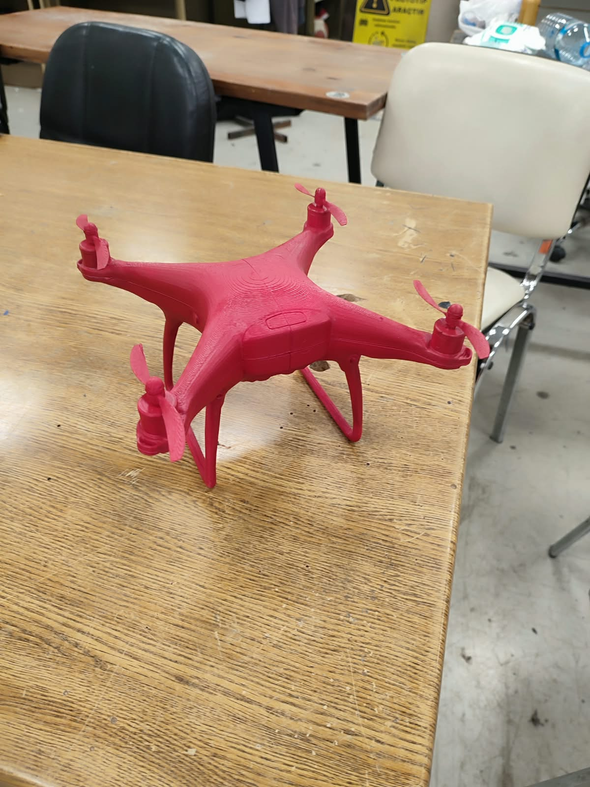

# Marmara Rover – Otonom Hedef Tespit ve Hizalama Görevi

**Son Teslim Tarihi: 20.10.2026**\
**Teslim:** GitHub Pull Request

## Görev Tanımı

Bu görev kapsamında adaylardan, kamera görüntüsü üzerinden kırmızı renkli, 3B yazıcıyla üretilmiş bir drone modelini: ["C:\Users\mtari\Downloads\WhatsApp Image 2026-10-12 at 16.45.35.jpeg"]&#x20;



YOLO kullanarak tespit eden ve iki eksenli NEMA 17 step motorlarla hedef arama modunda hedefi tespit edip, tespit ettikten sonra hedefe otonom olarak hizalanan bir sistem geliştirmeleri beklenmektedir.

Sistem, hedefin kamera görüntüsündeki konumunu analiz ederek gerekli hareket komutlarını oluşturmalı, UART aracılığıyla mikrodenetleyiciye(ardunio UNO) iletmeli ve hedef görüntünün merkezine gelene kadar hareketini otomatik olarak kontrol etmelidir.

## Teknik Gereksinimler

- **Laptop yazılımı:** Python
- **Nesne tespiti:** YOLO
- **Dataset:** Araştırılacak ve uygun veri setiyle(Hazır veya kendi veri setiniz) model eğitilecektir.
- **MCU:** Ardunio UNO; programlama dili serbesttir.
- **Haberleşme:** UART&#x20;
- **Motor kontrolü:** NEMA 17 step motorların yaw ve pitch eksenlerinde kontrolü.
- **Arayüz:** Çeşitli arayüzler serbesttir. Canlı kamera görüntüsü ve sistemi durdurma işlevi zorunludur.

## Repository Yapısı

```
Target-Tracking-Challenge/
├── hedef-drone.jpeg
├── hedef_hizalama/
│   ├── targeting_system/
│   ├── dashboard/
│   ├── mcu/
│   └── yolo/
└── README.md
```

**hedef_hizalama/targeting_system/** – Laptop üzerinde çalışan hedef tespit, konum hesaplama, otonom hizalama ve UART haberleşmesi.

**hedef_hizalama/dashboard/** – Kamera görüntüsünün gösterilmesi, sistem durumunun izlenmesi ve durdurma kontrolü.

**hedef_hizalama/mcu/** – Mikrodenetleyici yazılımı, seri haberleşme ve STEP/DIR motor kontrolü.

**hedef_hizalama/yolo/** – Kullanılan datasetin bilgileri, eğitim sonuçları ve eğitilen YOLO model dosyası.

## GitHub Teslim Süreci

1. Adaylar kendilerine sağlanan repository üzerinden tercih ettikleri Git çalışma yöntemiyle geliştirmelerini gerçekleştirecektir.
2. Yapılan geliştirmeler anlamlı commit'lerle kaydedilecektir.
3. Çalışmalar tamamlandığında değişiklikler GitHub'a aktarılacak ve değerlendirme için **Pull Request** oluşturulacaktır.
4. Pull Request açıklamasında geliştirilen sistem, kullanılan teknolojiler ve karşılaşılan problemler belirtilecektir.

## Beklenen Sonuç

Hedefi YOLO ile tespit edebilen, hedefe otonom hizalanabilen, UART üzerinden mikrodenetleyiciyle haberleşen ve arayüz aracılığıyla güvenli şekilde durdurulabilen çalışan bir sistem.

Hedef kaybında veya başlangıçta sistem hedefi arama moduna girmelidir.

**Değerlendirme:** Algoritmanın doğruluğu, tespit başarısı, motor kontrolü, yazılım mimarisi, hata yönetimi ve GitHub çalışma düzeni dikkate alınacaktır.
